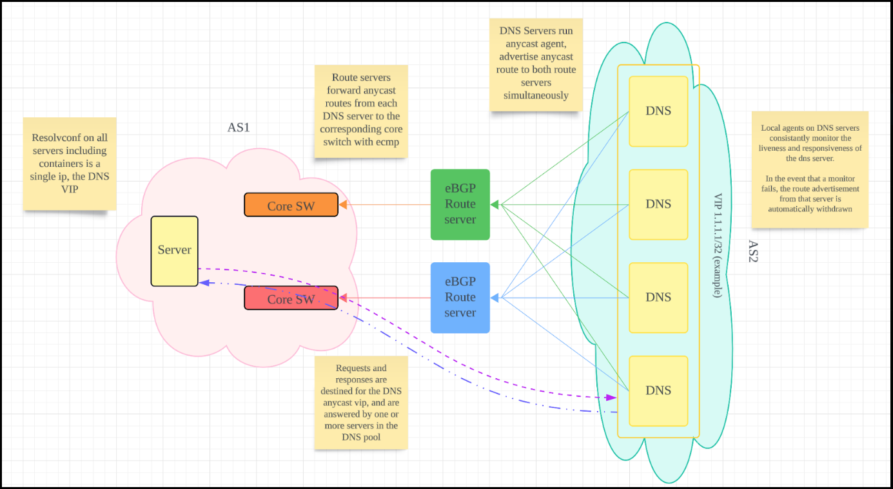

# Anycast Service Ansible Reconstruction

This is a reconstructed Ansible repository for the Anycast-as-a-Service design discussed in the shared chat.

The important pattern is:

```text
dns/syslog roles declare service subscription metadata
  -> gocast role consumes local anycast_services
  -> GoCast monitors subscribed local services
  -> healthy services advertise /32 VIPs
  -> routeserver role deploys GoBGP route servers in each datacenter
  -> route servers peer with agents and core switches
  -> route servers forward permitted VIP routes into the datacenter network
```

## Deployment Diagram



It is not intended to be the original historical source. It is a plausible role layout using conventional Ansible structure and a simple service metadata model: `anycast: true` plus `vip`.

## Requirements Captured

- Improve DNS reliability by giving a pool of DNS servers a shared VIP that production servers and containers can place in `resolv.conf`.
- Improve network-device Syslog reliability with a static VIP instead of a DNS name, since many network devices require literal IP targets.
- Monitor subscribed services locally and perform automated failover/failback from GoCast monitor results.
- Make services easy to subscribe to Anycast by setting service metadata such as `anycast: true` and `vip`.
- Define agent and route-server deployment in unique Ansible roles for assignment by a global provisioning service.

## Layout

```text
.
├── ansible.cfg
├── inventories/example/hosts.yml
├── group_vars/all/anycast.yml
├── playbooks/site.yml
└── roles/
    ├── dns/
    ├── syslog/
    ├── gocast/
    └── routeserver/
```

## Role Responsibilities

`dns`
: Installs/configures a DNS service and registers DNS with the host-local `anycast_services` list when `dns.anycast` is enabled.

`syslog`
: Installs/configures rsyslog and registers Syslog with `anycast_services` when `syslog.anycast` is enabled.

`gocast`
: Installs/renders the GoCast BGP agent on application hosts. Upstream GoCast uses a single `peer_ip` in its BGP config, so this role runs one GoCast instance per route server, each with its own config and systemd unit such as `gocast-rs01.service` and `gocast-rs02.service`.

The upstream GoCast config model has one BGP peer per process:

```yaml
bgp:
  local_as: 65010
  peer_as: 65000
  local_ip: 10.1.10.11
  peer_ip: 10.1.0.11
```

Because the original design peered each Anycast agent with multiple redundant route servers, the reconstructed role models that as multiple local GoCast processes:

```yaml
gocast_asn: 65010
rs_asn: 65000
core_asn: 64512
```

```text
gocast-rs01.service -> /etc/gocast/gocast-rs01.yaml -> peer_ip 10.1.0.11
gocast-rs02.service -> /etc/gocast/gocast-rs02.yaml -> peer_ip 10.1.0.12
```

The mapping is explicit in vars:

```yaml
route_servers:
  - name: rs01
    address: 10.1.0.11
    listen_addr: ":8081"
  - name: rs02
    address: 10.1.0.12
    listen_addr: ":8082"
```

Each instance receives the same `anycast_services` subscription list, so it monitors the same DNS/Syslog VIPs and withdraws only from its respective route-server peer. The systemd unit is ordered after the subscribed service units declared by the service roles.

`routeserver`
: Installs/renders the GoBGP route-server configuration in each datacenter. Route servers peer with Anycast agents on one side and core switches on the other, then export only approved Anycast VIP prefixes into the datacenter network.

The example inventory intentionally uses ordinary pre-existing groups:

```yaml
dns_servers:
syslog_servers:
bgp_route_servers:
```

Anycast subscription is not represented as an inventory group. It is introduced by service role variables (`anycast: true`, `vip`) and by assigning the `gocast` role after the local service role has registered its metadata.

## Example Run

Render example GoCast and route-server configs:

```bash
ANSIBLE_LOCAL_TEMP=/tmp/ansible-local \
ANSIBLE_REMOTE_TEMP=/tmp/ansible-remote \
ANSIBLE_HOME=/tmp/ansible-home \
ansible-playbook examples/render.yml
```

Generated examples:

```text
examples/generated/gocast/gocast-rs01.yaml
examples/generated/gocast/gocast-rs02.yaml
examples/generated/routeserver/gobgpd-rs01.conf
examples/generated/routeserver/gobgpd-rs02.conf
```

Syntax check:

```bash
ansible-playbook -i inventories/example/hosts.yml playbooks/site.yml --syntax-check
```

Dry run:

```bash
ansible-playbook -i inventories/example/hosts.yml playbooks/site.yml --check --diff
```

The example inventory uses local connection and placeholder package names. Adjust package names, binary deployment, ASNs, and peer addresses for the target OS/network.
